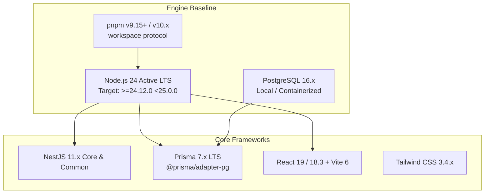
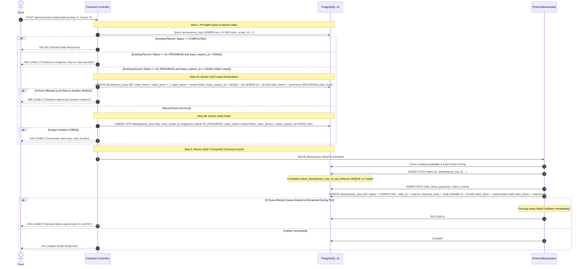
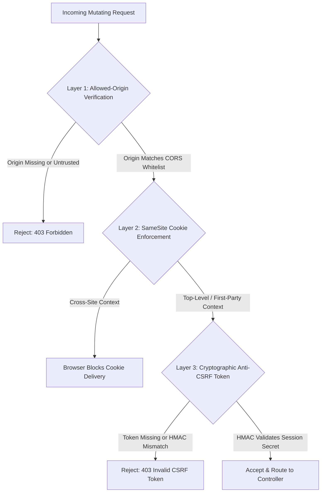

# PROJECT GENESIS — P0 ARCHITECTURE AND ENGINEERING BLUEPRINT

## High-Reliability Restaurant Commerce & Operations Platform

### Revision 1.2.0-RC (Reliability, Concurrency & Security Hardened)

---

### Document Control & Revision History

| Version          | Date       | Author                                    | Review Status                            | Summary of Major Changes                                                                                                                                                                                                                                                                                                                                                                                                                                                                                                                                                                                                                                                                                                                                                                                                                                                                                                                                                                                                                                                                                                                                                                                                                            |
| :--------------- | :--------- | :---------------------------------------- | :--------------------------------------- | :-------------------------------------------------------------------------------------------------------------------------------------------------------------------------------------------------------------------------------------------------------------------------------------------------------------------------------------------------------------------------------------------------------------------------------------------------------------------------------------------------------------------------------------------------------------------------------------------------------------------------------------------------------------------------------------------------------------------------------------------------------------------------------------------------------------------------------------------------------------------------------------------------------------------------------------------------------------------------------------------------------------------------------------------------------------------------------------------------------------------------------------------------------------------------------------------------------------------------------------------------- |
| **1.0.0**        | 2026-10-11 | Principal Architect                       | Reviewed (Corrections Required)          | Initial architectural blueprint.                                                                                                                                                                                                                                                                                                                                                                                                                                                                                                                                                                                                                                                                                                                                                                                                                                                                                                                                                                                                                                                                                                                                                                                                                    |
| **1.1.0-FROZEN** | 2026-10-11 | Principal Architect & Reliability Lead    | Reviewed (Follow-up Required)            | Upgraded runtime to Node 24 / Prisma 7; parameter-driven GST model; dual-key QR structure; consolidated billing.                                                                                                                                                                                                                                                                                                                                                                                                                                                                                                                                                                                                                                                                                                                                                                                                                                                                                                                                                                                                                                                                                                                                    |
| **1.2.0-RC**     | 2026-10-11 | Reliability Engineer & Security Architect | **RELEASE CANDIDATE / READY FOR REVIEW** | • **Correction A (Idempotency Concurrency):** Eliminated split-brain lease expiry race. Added `claim_fence` generation token, compare-and-swap (CAS) renewal, and database-level `orders.idempotency_key_id UNIQUE` constraint.<br>• **Correction B (Dine-In Authorization):** Introduced operational Pairing Code lifecycle with staff confirmation. Clarified physical presence boundaries; corrected HMAC construction (server-side secret as key).<br>• **Correction C (Outbox Recovery):** Added worker claim leases, atomic stale-claim recovery (`SKIP LOCKED`), ownership verification on publish, sequence numbers, and poison queue.<br>• **Correction D (Exact Arithmetic):** Replaced all floating-point math with exact `BigInt` / integer paise rational arithmetic, `divideHalfUp` formulation, and representative boundary test vectors.<br>• **Correction E (Security & CSRF):** Specified multi-layer CSRF defense (Origin verification + HMAC Double-Submit CSRF tokens), cross-origin cookie policy, WebSocket upgrade validation, and staff privilege invalidation.<br>• **Correction F (Reconciliation):** Reconciled status vocabularies, field names, and clarified documentation-verified vs executable-tested boundaries. |

---

## 1. Executive Summary & Verification Methodology

This specification defines the engineering foundations for **Aurel**, a high-reliability restaurant commerce and operations platform. Designed as a rigorous backend engineering showcase, the platform emphasizes **concurrency safety, relational data integrity, financial precision, and defense-in-depth security**.

### Verification Disclosure

- **Independently Verified on Local Host:** Git 2.55.0 (`C:\Program Files\Git`), PostgreSQL 16 (`C:\Program Files\PostgreSQL\16`), and absence of Node.js / pnpm in Windows environment PATH.
- **Documentation-Verified via Official Documentation:** Node.js 24 Active LTS lifecycle schedules (Active LTS through April 2028), Prisma 7 LTS driver adapters and interactive transactions, NestJS 11 platform-express compatibility, and Indian GST composite supply tax notifications.
- **Executable Testing Status:** Full integration behavior will be validated through automated test gates in Milestone P1.

---

## 2. Dependency Baseline & Runtime Configuration



### Engine Constraints in `package.json`

```json
{
  "name": "aurel-platform",
  "private": true,
  "engines": {
    "node": ">=24.12.0 <25.0.0",
    "pnpm": ">=9.15.0"
  },
  "packageManager": "pnpm@9.15.4"
}
```

---

## 3. Concurrency-Safe Checkout & Idempotency Engine

### 3.1 The Split-Brain Vulnerability in Naive Leases

A naive timeout (e.g. "reclaim lock if `locked_at` > 30s") is vulnerable to overlapping executions:

1. Worker A claims an idempotency lease and begins order processing.
2. Worker A encounters an unexpected 35-second garbage collection or external delay.
3. At 30 seconds, Worker B reclaims the lease.
4. Worker A wakes up and commits Order 1. Worker B finishes and commits Order 2.
5. **Result: Two orders created for the identical checkout submission.**

### 3.2 The Aurel Concurrency & Fencing Solution



### 3.3 Relational Invariants & Database Schema

```sql
-- Idempotency keys registry
CREATE TABLE idempotency_keys (
    id UUID PRIMARY KEY DEFAULT gen_random_uuid(),
    key VARCHAR(64) NOT NULL,
    actor_scope_id VARCHAR(64) NOT NULL,
    request_fingerprint CHAR(64) NOT NULL,
    status VARCHAR(20) NOT NULL DEFAULT 'IN_PROGRESS', -- IN_PROGRESS, COMPLETED, FAILED
    claim_token UUID NOT NULL,
    claim_fence BIGINT NOT NULL DEFAULT 1,
    lease_expires_at TIMESTAMPTZ NOT NULL,
    order_id UUID NULL,
    response_code INT NULL,
    response_body JSONB NULL,
    created_at TIMESTAMPTZ NOT NULL DEFAULT NOW(),
    updated_at TIMESTAMPTZ NOT NULL DEFAULT NOW(),
    CONSTRAINT uq_idempotency_scope UNIQUE (key, actor_scope_id)
);

-- Crucial: Orders table enforces exact 1:1 relationship with idempotency identity!
ALTER TABLE orders
ADD COLUMN idempotency_key_id UUID NOT NULL,
ADD CONSTRAINT uq_orders_idempotency_key UNIQUE (idempotency_key_id),
ADD CONSTRAINT fk_orders_idempotency_key FOREIGN KEY (idempotency_key_id) REFERENCES idempotency_keys(id) ON DELETE RESTRICT;
```

#### Why Two Workers Cannot Commit Two Orders

1. **Application Layer:** Fencing token `claim_fence` must match at commit time; if Worker A was preempted, its `UPDATE idempotency_keys` matches 0 rows and rolls back.
2. **Database Engine:** The unique constraint `uq_orders_idempotency_key` guarantees at the storage engine level that PostgreSQL will abort any attempt to insert a second order row referencing the same `idempotency_key_id`.

---

## 4. Two-Tier Dine-In Physical Authorization Protocol

### 4.1 Physical Presence & Threat Model

A static QR code on a restaurant table can be photographed and triggered remotely. No static URL signature can prove that a customer is physically sitting at Table 4.

### 4.2 The Operational Pairing Protocol

```mermaid
sequenceDiagram
    autonumber
    actor Patron
    actor Waitstaff
    participant Ops as Operations App
    participant API as Core API
    participant DB as PostgreSQL 16

    Patron->>Waitstaff: Arrives & Seated at Table 4
    Waitstaff->>Ops: Opens Table 4 Session
    Ops->>API: POST /api/v1/dining-tables/T04/sessions
    API->>DB: INSERT table_sessions (status: ACTIVE)
    API->>DB: Generate 4-digit Pairing Code: '7392' (TTL: 15 mins)
    DB-->>Ops: Displays Pairing Code '7392'
    Waitstaff->>Patron: Verbally provides code or presents printed welcome ticket

    Patron->>API: Scans Permanent Table QR: GET /dine-in?table=T04&sig=HMAC(T04, Secret)
    API-->>Patron: Validates Table Sig; Prompts for Active Pairing Code

    Patron->>API: POST /api/v1/dining-tables/T04/pair (Code: '7392')
    alt Invalid Code (Rate limited to 5 attempts per IP)
        API-->>Patron: 401 Unauthorized ("Invalid Pairing Code")
    else Code Valid
        API->>DB: Increment pairing use count; Register Guest Session
        API-->>Patron: Sets HttpOnly Cookie: dine_in_guest_token (TTL: 3h, Scoped to Session ID)
    end

    Note over Patron,API: Patron submits batch orders using verified guest token

    Waitstaff->>Ops: Finalizes Bill & Closes Table Session
    Ops->>API: POST /api/v1/dining-tables/T04/close
    API->>DB: UPDATE table_sessions SET status = 'CLOSED'
    Note over DB: All guest tokens tied to this session instantly revoked!
```

### 4.3 Cryptographic Integrity Specifications

1. **Permanent Table HMAC Keying:**
   $$\text{TableSignature} = \text{HMAC\_SHA256}(\text{table\_id} + \text{salt}, \text{DINING\_HMAC\_SECRET})$$
   _Correction Applied:_ The HMAC key is a private, server-managed master secret (`DINING_HMAC_SECRET`), **not** public table metadata.
2. **Ephemeral Pairing Code:**
   - 4-digit cryptographically random numeric code generated on staff session opening.
   - Stored in hashed format (`pairing_code_hash = SHA256(code + salt)`).
   - Maximum 5 failed attempts per IP address before a 15-minute lockout.
3. **Multi-Guest Pairing:**
   - All patrons seated at the same table can enter the pairing code within the 15-minute pairing window.
   - Each guest receives an independent `guest_token`, all bound to the identical active `table_session_id`.
4. **Immediate Invalidation:**
   - When waitstaff marks the table session `CLOSED`, all active guest tokens linked to that session are rendered invalid.

---

## 5. Transactional Outbox Crash Recovery & Guarantees

### 5.1 Outbox Table Schema & State Machine

```sql
CREATE TABLE outbox_events (
    id UUID PRIMARY KEY DEFAULT gen_random_uuid(),
    aggregate_type VARCHAR(50) NOT NULL,
    aggregate_id UUID NOT NULL,
    sequence_number BIGINT NOT NULL,
    event_type VARCHAR(50) NOT NULL,
    payload JSONB NOT NULL,
    status VARCHAR(20) NOT NULL DEFAULT 'PENDING', -- PENDING, PROCESSING, PUBLISHED, DEAD_LETTER
    claimed_by_worker_id UUID NULL,
    claim_fence BIGINT NOT NULL DEFAULT 1,
    lease_expires_at TIMESTAMPTZ NULL,
    retry_count INT NOT NULL DEFAULT 0,
    scheduled_at TIMESTAMPTZ NOT NULL DEFAULT NOW(),
    published_at TIMESTAMPTZ NULL,
    last_error TEXT NULL,
    created_at TIMESTAMPTZ NOT NULL DEFAULT NOW()
);

CREATE INDEX idx_outbox_polling ON outbox_events (status, scheduled_at) WHERE status IN ('PENDING', 'PROCESSING');
```

### 5.2 Atomic Poller & Lease Recovery Query

```sql
-- Atomic Claim & Stale Lease Recovery (Executed every 500ms)
WITH claimable AS (
    SELECT id
    FROM outbox_events
    WHERE (status = 'PENDING' AND scheduled_at <= NOW())
       OR (status = 'PROCESSING' AND lease_expires_at <= NOW())
    ORDER BY sequence_number ASC, created_at ASC
    LIMIT 25
    FOR UPDATE SKIP LOCKED
)
UPDATE outbox_events
SET status = 'PROCESSING',
    claimed_by_worker_id = :workerUuid,
    claim_fence = claim_fence + 1,
    lease_expires_at = NOW() + INTERVAL '15 SECONDS'
FROM claimable
WHERE outbox_events.id = claimable.id
RETURNING outbox_events.id, aggregate_type, aggregate_id, sequence_number, event_type, payload, claim_fence;
```

### 5.3 Fenced Publication Completion

Following network emission to Socket.IO, the worker marks the event published:

```sql
UPDATE outbox_events
SET status = 'PUBLISHED',
    published_at = NOW()
WHERE id = :id
  AND claimed_by_worker_id = :workerUuid
  AND claim_fence = :myFence;
```

If rows affected == 0, the worker's lease expired and another worker reclaimed the row. Duplicate emission is safely tolerated because consumers are idempotent.

### 5.4 Multi-Tier Delivery Guarantees Summary

| Layer                | What Is Guaranteed                                                                            | What Is NOT Guaranteed                                            |
| :------------------- | :-------------------------------------------------------------------------------------------- | :---------------------------------------------------------------- |
| **Database Engine**  | Atomic commit of business state and outbox event row within single `$transaction`.            | External network delivery.                                        |
| **Outbox Worker**    | At-least-once handover of event payload to the Socket.IO cluster.                             | That the recipient's browser is connected or receives the packet. |
| **Transport Layer**  | Ephemeral packet broadcast to subscribed rooms.                                               | Durable delivery across disconnections.                           |
| **Client / Browser** | Sequence tracking: gap detection triggers canonical REST synchronization (`GET /orders/:id`). | Real-time delivery if client device loses cellular connectivity.  |

---

## 6. Exact Financial & Rational Arithmetic Engine

### 6.1 Integer Paise Representation & Exact Half-Up Division

All monetary amounts are represented as integer paise ($1\text{ INR} = 100\text{ paise}$). Tax rates and discounts are represented in integer basis points ($1\% = 100\text{ bps}$, $5\% = 500\text{ bps}$, $2.5\% = 250\text{ bps}$).

#### Deterministic Integer Half-Up Division Formulation

To avoid JavaScript floating-point representation errors (`0.1 + 0.2 !== 0.3`):
$$\text{divideHalfUp}(N, D) = \left\lfloor \frac{2N + D}{2D} \right\rfloor = \left\lfloor \frac{N + \lfloor D / 2 \rfloor}{D} \right\rfloor \quad (\text{for } N, D \ge 0)$$

```typescript
export function divideHalfUp(numerator: bigint, denominator: bigint): bigint {
  if (denominator === 0n) throw new Error('Division by zero');
  return (numerator + denominator / 2n) / denominator;
}
```

### 6.2 Overflow Analysis & Numeric Types

- **Max Restaurant Transaction:** ₹10,000,000 ($10^9$ paise).
- **PostgreSQL `INTEGER` Limit:** $2,147,483,647$ (approx ₹2.14 crore).
- **Multiplication Safety:** $\text{Subtotal (Paise)} \times \text{Rate (Basis Points)} = 10^9 \times 500 = 5 \times 10^{11}$, which exceeds PostgreSQL `INTEGER` and 32-bit registers.
- **Architectural Policy:** Intermediate arithmetic operates strictly on JavaScript `bigint`. Storage columns use PostgreSQL `INTEGER` (up to ₹2.14 crore per line item) or `BIGINT` for cumulative daily reporting totals.

### 6.3 Representative Test Vectors

#### Test Vector 1: Standard Tax-Exclusive Single Item (5% GST Split)

- **Item Base:** ₹249 (24,900 paise). CGST = 250 bps, SGST = 250 bps.
- $\text{CGST} = \text{divideHalfUp}(24900\text{n} \times 250\text{n}, 10000\text{n}) = \text{divideHalfUp}(6225000\text{n}, 10000\text{n}) = 623\text{ paise}$ (₹6.23).
- $\text{SGST} = \text{divideHalfUp}(24900\text{n} \times 250\text{n}, 10000\text{n}) = 623\text{ paise}$ (₹6.23).
- $\text{Total Tax} = 623 + 623 = 1,246\text{ paise}$ (₹12.46).
- $\text{Payable Total} = 24,900 + 1,246 = 26,146\text{ paise}$ (₹261.46).

#### Test Vector 2: Composite Supply with Delivery & Packaging

- **Items Subtotal:** ₹400 (40,000 paise).
- **Packaging Charge:** ₹30 (3,000 paise).
- **Delivery Surcharge:** ₹50 (5,000 paise).
- $\text{Taxable Base} = 40,000 + 3,000 + 5,000 = 48,000\text{ paise}$.
- $\text{CGST} = \text{divideHalfUp}(48000\text{n} \times 250\text{n}, 10000\text{n}) = 1,200\text{ paise}$ (₹12.00).
- $\text{SGST} = \text{divideHalfUp}(48000\text{n} \times 250\text{n}, 10000\text{n}) = 1,200\text{ paise}$ (₹12.00).
- $\text{Payable Total} = 48,000 + 1,200 + 1,200 = 50,400\text{ paise}$ (₹504.00).

#### Test Vector 3: Tax-Inclusive Reverse Extraction

- **Gross Bill:** ₹210 (21,000 paise). GST Rate = 500 bps (5%).
- $\text{Taxable Base} = \text{divideHalfUp}(21000\text{n} \times 10000\text{n}, 10500\text{n}) = 20,000\text{ paise}$ (₹200.00).
- $\text{Total Tax} = 21,000 - 20,000 = 1,000\text{ paise}$ (₹10.00).
- $\text{CGST} = 500\text{ paise}$ (₹5.00), $\text{SGST} = 500\text{ paise}$ (₹5.00).

---

## 7. Multi-Layer Session, Cookie & CSRF Security Policy

### 7.1 Defense-in-Depth CSRF Contract

A static custom header (`X-Requested-With`) alone is insufficient defense. Aurel enforces three mandatory validation layers for all cookie-authenticated mutations (`POST`, `PUT`, `PATCH`, `DELETE`):



1. **Layer 1 (Origin / Referer Whitelisting):** The server verifies that the HTTP `Origin` header matches configured trusted domains (`https://aurel.restaurant`, `https://ops.aurel.restaurant`).
2. **Layer 2 (Strict Cookie Attributes):**
   ```text
   Set-Cookie: aurel_session=<token>; HttpOnly; Secure; SameSite=Lax; Path=/; Max-Age=604800
   ```
3. **Layer 3 (Double-Submit HMAC Anti-CSRF Token):**
   - Upon session creation, an HMAC-signed CSRF token is issued in a readable cookie (`aurel_csrf`).
   - The client must echo this value in the `X-CSRF-Token` header for all mutating requests.
   - The backend validates that $\text{X-CSRF-Token} == \text{HMAC\_SHA256}(\text{session\_id}, \text{CSRF\_SECRET})$.

### 7.2 Staff Privilege Revocation

The `users` table maintains a `token_version INT DEFAULT 1` column. When an administrator modifies a staff member's role or deactivates an account, `token_version` is incremented. All active sessions with mismatched token versions are immediately rejected at the auth guard boundary.

### 7.3 WebSocket Upgrade Handshake Security

- The WebSocket upgrade request inspects the `Origin` header against the CORS whitelist.
- Authenticates the session cookie during the handshake.
- Clients can only join rooms authorized for their identity:
  - Customers: `room:order:{id}` only if `order.user_id == session.user_id` or matching guest token.
  - Staff: `room:kitchen` only if user possesses `order:prep` permission.

---

## 8. Consolidated Dine-In Settlement Data Model

```sql
CREATE TABLE consolidated_bills (
    id UUID PRIMARY KEY DEFAULT gen_random_uuid(),
    table_session_id UUID NOT NULL REFERENCES table_sessions(id) ON DELETE RESTRICT,
    bill_number VARCHAR(35) UNIQUE NOT NULL,
    status VARCHAR(20) NOT NULL DEFAULT 'DRAFT', -- DRAFT, FINALIZED, PAID, VOIDED
    subtotal_in_paise INT NOT NULL CHECK (subtotal_in_paise >= 0),
    cgst_in_paise INT NOT NULL CHECK (cgst_in_paise >= 0),
    sgst_in_paise INT NOT NULL CHECK (sgst_in_paise >= 0),
    discount_in_paise INT NOT NULL DEFAULT 0 CHECK (discount_in_paise >= 0),
    total_payable_in_paise INT NOT NULL CHECK (total_payable_in_paise >= 0),
    finalized_by_user_id UUID NOT NULL REFERENCES users(id),
    created_at TIMESTAMPTZ NOT NULL DEFAULT NOW(),
    paid_at TIMESTAMPTZ NULL
);

CREATE TABLE bill_payment_attempts (
    id UUID PRIMARY KEY DEFAULT gen_random_uuid(),
    bill_id UUID NOT NULL REFERENCES consolidated_bills(id) ON DELETE RESTRICT,
    payment_method VARCHAR(30) NOT NULL, -- SIMULATED_CARD, SIMULATED_UPI, CASH
    status VARCHAR(20) NOT NULL DEFAULT 'INITIATED', -- INITIATED, SUCCESS, FAILED
    amount_in_paise INT NOT NULL CHECK (amount_in_paise > 0),
    external_reference VARCHAR(100) UNIQUE NOT NULL,
    failure_reason TEXT NULL,
    created_at TIMESTAMPTZ NOT NULL DEFAULT NOW()
);
```

---

## 9. Phased Testing Acceptance Criteria

### Milestone P1 Acceptance Gate (Foundation Scaffolding)

- Root `pnpm build` executes across `apps/api`, `apps/web-storefront`, `apps/web-operations`, and `packages/shared-types` with zero TypeScript errors under `"strict": true`.
- ESLint flat configuration passes across all workspaces with zero warnings.
- Local PostgreSQL 16 connection established; baseline Prisma 7 migration applies cleanly.
- `GET /api/v1/health` returns `{ status: "ok" }`.
- Swagger UI accessible at `/api/docs`.

### Milestone P2 Acceptance Gate (Identity & Catalog)

- Argon2id password hashing and session cookie issuance verified via Supertest.
- PostgreSQL partial unique index `idx_unique_active_table_session` verified: attempting to insert a second active session for the same table throws 23505.
- Item 86 toggle immediately updates availability status.

### Milestone P3 Acceptance Gate (Pricing & Checkout Reliability)

- **Rational Arithmetic Test Suite:** 100% passing tests for test vectors 1, 2, 3 and edge boundary values (zero price, large orders).
- **Concurrency Fencing Test:** 20 parallel checkout submissions using identical `Idempotency-Key` yield **exactly 1 order** committed to PostgreSQL (1x 201 Created, 19x 409 Conflict).
- **Lease Expiry Recovery:** Submitting a retry after 31 seconds with an identical payload safely reclaims the lease.

### Milestone P4 Acceptance Gate (Outbox, Fulfillment & Dining Tables)

- Outbox worker crashes simulated mid-processing; restarted worker safely reclaims stranded rows via `lease_expires_at` CAS query.
- Dining table pairing flow verified: invalid pairing code rejected; active pairing code issues 3-hour guest cookie; closing table session instantly invalidates all guest cookies.
- Consolidated billing lifecycle verified: multiple batch orders roll into single bill.

### Milestone P5 & P6 Gate (Frontends)

- Customer storefront mobile/desktop journeys verified.
- Operations workspace real-time kitchen queue audio/visual notifications verified.

### Milestone P7 Gate (Reliability & Deployment)

- Full Playwright E2E automation passing.
- Production deployment on cloud PaaS verified with live health checks.

---

## 10. Documented Residual Risks & Assumptions

| Risk ID    | Description                                                 | Severity | Likelihood | Mitigation Strategy                                                                                         |
| :--------- | :---------------------------------------------------------- | :------- | :--------- | :---------------------------------------------------------------------------------------------------------- |
| **RSK-06** | Windows host currently lacks Node.js / pnpm in PATH.        | High     | Certain    | Node.js 24 Active LTS and pnpm must be installed on Windows host prior to starting P1 scaffolding commands. |
| **RSK-07** | Local PostgreSQL 16 credentials unconfigured.               | Medium   | Medium     | Verify superuser credentials and create `aurel_dev` database during initial P1 environment setup.           |
| **RSK-08** | Cloud media storage credentials unprovided in early phases. | Low      | High       | P1–P4 will utilize local static image mocks; cloud storage adapter plugged in during P5.                    |

---

## 11. Final Readiness Classification

**STATUS: READY FOR REVIEW**
_(This specification has resolved all reliability, concurrency, and security review findings and is frozen at Revision 1.2.0-RC awaiting formal Product Owner approval to begin Milestone P1 scaffolding.)_
